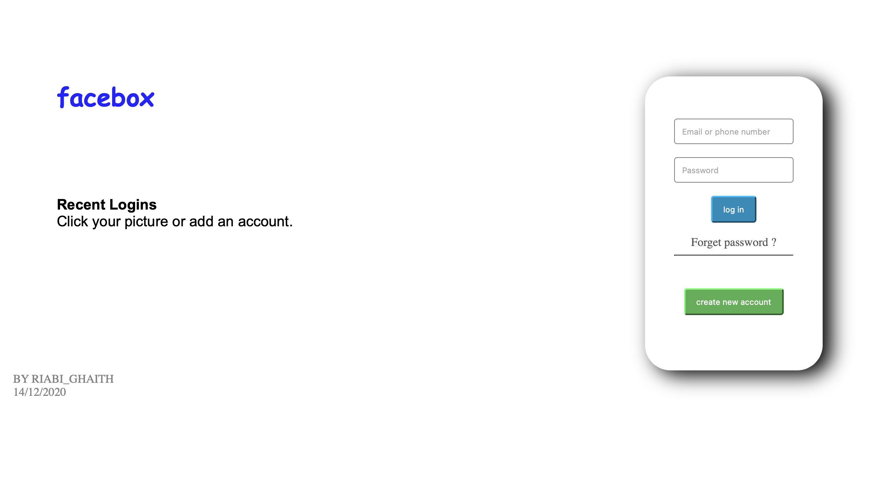

# Facebox Website 🌐

Facebox is a simple, responsive authentication interface built with HTML, CSS, and JavaScript. It includes a modern login page and a password recovery page.

## 🔗 Live Website

[Visit the live website](https://ghaith-riabi.netlify.app)

## 📷 Preview



## Changes From the Old Version to the New Version

### Old Version

- HTML, CSS, and JavaScript were written inside the same HTML pages.
- The layout was fixed and not fully responsive.
- The two pages did not share a consistent structure or design.
- There was no dynamic dark mode.
- Password visibility could not be toggled.
- The forms had no useful client-side validation.
- The create-account button did not open a signup form.
- The password recovery page had poor spacing and used an incorrect home-page link.
- The repeated styles and scripts made the project difficult to maintain.

### New Version

- Extracted all shared styles into `styles.css`.
- Extracted JavaScript behavior into `app.js`.
- Added a modern, clean, and responsive login layout.
- Rebuilt `forgetp.html` as a separate password recovery page.
- Added persistent light and dark themes using `localStorage`.
- Added a show/hide password control.
- Added login validation for missing email or password values.
- Added password recovery validation.
- Added a functional create-account modal.
- Kept the interface consistent with blue primary actions and green success actions.
- Improved spacing, typography, borders, shadows, focus states, and hover states.
- Added mobile, tablet, and desktop breakpoints.
- Replaced broken or unnamed page links with valid navigation links.

## Project Structure

- `index.html` — Login page and signup modal.
- `forgetp.html` — Password recovery page.
- `styles.css` — Shared responsive styles for both pages.
- `app.js` — Theme switching, password controls, modal behavior, and form validation.
- `assets/preview.png` — Website preview image.

## Run Locally

Start a local static server:

```bash
python3 -m http.server 4173
```

Then open:

```text
http://127.0.0.1:4173/index.html
```

## ⚠️ License

This project is protected. Unauthorized use, copying, or redistribution is prohibited.

© 2025 Ghaith Riabi — All rights reserved.
